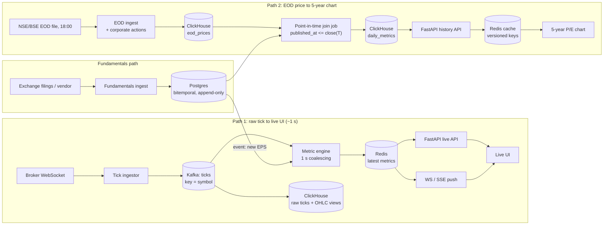

# Multi-Frequency Financial Data Platform: Design Document

**Scope:** NSE + BSE universe (~5,000 symbols), four frequencies (tick, daily, quarterly, annual).
**Worked example throughout:** P/E = Price / EPS(TTM).

## Design principles

1. **Split by access pattern, not by "one database to rule them all."** Ticks, fundamentals and hot metrics have different shapes, so they get different stores.
2. **One immutable source of truth; everything else is derived and rebuildable.** If a derived number is wrong, we fix the input or the formula and recompute. We never patch outputs.
3. **Exploit the frequency gap.** Price moves ~3×/second; EPS moves ~4×/year. The system should do work proportional to change, not to the clock.

---

## Q1. Storage

### Stack

| Data | Store | Why |
|---|---|---|
| Live ticks (transport) | **Kafka**, key = symbol | Durable buffer, replay, fan-out to several consumers. Per-symbol ordering via partitioning. |
| Tick history + OHLC | **ClickHouse** | Columnar, very high ingest, 10–20× compression on time series (DoubleDelta + ZSTD), cheap aggregations. |
| Latest metrics / latest tick | **Redis** (hash per symbol) | Sub-millisecond reads for the live API. Disposable: rebuilt from Kafka and Postgres. |
| EOD prices + corporate actions | **ClickHouse** | ~5,000 × 250 days × 20 years is only ~25M rows; trivial. Kept next to the tick data for joins. |
| Fundamentals (quarterly, annual) | **PostgreSQL** | Small, relational, needs constraints and transactional, versioned writes. A few thousand filings per quarter; not a scale problem. |

**Sizing sanity check.** 5,000 symbols at ~300 ms is ~17k ticks/s, and NSE/BSE are open ~6.25 h (22,500 s), so ~375M ticks/day. At ~40 bytes raw that is ~15 GB/day uncompressed, ~1.5–3 GB/day compressed in ClickHouse, which is **single-digit TB per year**. Kafka handles 17k msg/s on a small cluster without effort. The petabyte figure only applies if we store full order-book depth. For LTP + volume it is terabytes, and I would size for that rather than design for a scale we don't have.

I did not choose Flink/Spark Streaming: at this rate a partitioned Kafka consumer group doing O(1) arithmetic per symbol is sufficient and far simpler to operate.

### Point-in-time correctness (the core of the design)

Fundamentals are **bitemporal and append-only**. Nothing is ever updated or deleted.

```sql
CREATE TABLE fundamentals (
  symbol        TEXT        NOT NULL,
  metric        TEXT        NOT NULL,   -- 'eps', 'revenue', 'book_value', 'dividend'
  period_type   TEXT        NOT NULL,   -- 'Q' | 'A'
  period_end    DATE        NOT NULL,   -- which quarter/year the number describes
  value         NUMERIC     NOT NULL,
  published_at  TIMESTAMPTZ NOT NULL,   -- when the MARKET could first know it (exchange filing timestamp)
  recorded_at   TIMESTAMPTZ NOT NULL DEFAULT now(),  -- when WE ingested it (audit)
  filing_id     TEXT        NOT NULL,
  PRIMARY KEY (symbol, metric, period_type, period_end, published_at)
);
```

- `period_end` answers "which quarter?"; `published_at` answers "when did the market learn it?"; `recorded_at` answers "when did we learn it?". Conflating the first two is the classic look-ahead bug.
- **A restatement is a new row** for the same `period_end` with a later `published_at`. The old row stays.
- **As-of query:** for each of the last four `period_end`s, take the row with the greatest `published_at <= T`, then sum to get TTM EPS. TTM is **derived, never stored as a source fact.**

**Worked example.** Company publishes Q3 EPS ₹20 at 19:00 IST Tuesday, so `published_at = Tue 19:00`.

- A query as of Tuesday 15:00 sees the previous quarter's data. ₹20 doesn't exist yet.
- A query as of Tuesday 20:00 sees ₹20.
- For **daily** charts, each day's point is evaluated as of that day's close (15:30). Tuesday's P/E therefore uses the old EPS, and **Wednesday's** is the first to use ₹20. This is correct, because the 19:00 result could not have influenced Tuesday's close.
- If a vendor doesn't give a trustworthy timestamp, we assume the conservative rule `published_at = next trading day open`. Being late is safe; being early is look-ahead bias.

**Split/bonus adjustment.** EPS is stored as reported. Prices are stored **raw**, with a separate `corporate_actions` table of adjustment factors applied at read time. A 1:2 split then adjusts both historical price and historical EPS by the same factor, **as known at the as-of date**, so the ratio stays consistent and history never needs rewriting.

### Archival and downsampling

- **Hot (0–30 days):** raw ticks in ClickHouse.
- **Always-on rollups:** materialized views continuously build 1-second and 1-minute OHLCV, plus daily bars, and these are kept forever. 1-minute bars are only ~1.9M rows/day for the whole universe.
- **Warm/cold (>30 days):** a TTL rule moves raw ticks to **Parquet (ZSTD) on S3**, partitioned by date. They remain queryable through ClickHouse's S3 table function for research and audits, at ~10× lower storage cost, then transition to Glacier after a year.
- **Why keep raw at all:** rollups can't be rebuilt if a bar is corrupt. Raw is the recovery source.

---

## Q2. Compute engine: on-write, on-read, or on-schedule?

**Hybrid, chosen by each metric's update frequency.**

**Live metrics: on-write, but split into slow and fast inputs.**
P/E = `price / eps_ttm`. `eps_ttm` changes a few times a year, so we keep the slow inputs (EPS TTM, book value, dividend, 52-week high, price 6 months ago) **pre-resolved in Redis** per symbol. The only fast input is price.

1. Tick arrives in Kafka (key = symbol, so one worker sees a symbol's ticks in order).
2. The metric engine holds only the **latest** tick per symbol in memory and marks the symbol *dirty*.
3. Every **1 second**, for dirty symbols only, compute `pe = price / eps_ttm`, `pb`, `yield`, `momentum` (pure O(1) arithmetic) and `HSET` to Redis, then publish to a stream for UI push.

This **coalesces** ~17k ticks/s into at most one update per symbol per second, which fits the stated second-level latency budget, and does almost no work for idle symbols.

**When EPS changes:** fundamentals ingestion writes to Postgres and emits an event. The engine refreshes that symbol's slow inputs and **recomputes immediately** rather than waiting for the next tick, which matters for illiquid stocks that may not tick for minutes.

**Why not on-read for live?** It would put a database lookup inside the 200 ms budget and repeat identical work for every viewer of a popular stock.

**Historical metrics: on-schedule, stored.**
After the 18:00 EOD load, a job performs the point-in-time join and writes `daily_metrics (symbol, date, pe, pb, yield, eps_used, eps_published_at)` to ClickHouse. Storing `eps_published_at` gives every point **lineage**, so any number can be audited. When a late filing or restatement arrives, only the affected symbol is recomputed from that `published_at` forward, as an idempotent upsert (versioned `ReplacingMergeTree`).

---

## Q3. APIs and serving

**Pattern A: live metrics, <200 ms.**
`GET /v1/stocks/{symbol}/metrics` → FastAPI → a single Redis `HGETALL`. There is **no database on the hot path**; the typical server-side time is a few milliseconds. Each payload carries an `as_of` timestamp, and keys carry a TTL: if the feed stalls, we show the value as *stale* rather than presenting an old number as live. Live push to the UI is WebSocket/SSE, fed from the Redis stream, with one subscription per visible symbol at 1 Hz. **Invalidation is unnecessary:** the value is overwritten on every change, so there is no cache to go stale.

**Pattern B: 3-year P/E chart (~750 points).**
`GET /v1/stocks/{symbol}/pe-history?years=3` reads the precomputed `daily_metrics` table. Ordered by `(symbol, date)`, this is one contiguous range scan of ~750 rows, which takes a few milliseconds. Nothing is computed per request.

- **Cache key includes a data version:** `pe:{symbol}:{range}:v{data_version}`. `data_version` is a per-symbol counter bumped by the EOD job or by a fundamentals event. **Invalidation is implicit:** a new version means a new key, and old keys expire by TTL. There are no explicit deletes and no race conditions.
- **History is immutable except at the tail.** We cache the series up to yesterday with a long TTL, and append today's live point from Redis at request time.
- **Stampede protection:** single-flight locking per key, and pre-warming popular symbols after the 18:00 job.

---

## Q4. The full picture: tracing one P/E



**Path 1 (live):** broker tick → Kafka (partitioned by symbol) → metric engine keeps the latest price, joins it with the cached EPS(TTM), and every second writes `pe` to Redis → API read or WebSocket push → UI. Target end-to-end: ~1–2 s.

**Path 2 (historical):** EOD file at 18:00 → raw price + corporate-action factors in ClickHouse → for each trading day in the window, the job picks the EPS versions with `published_at <= that day's close`, sums the last four quarters, applies split factors as of that date, divides → `daily_metrics` → history API → versioned cache → chart.

**Fundamentals** feed both: the event stream updates the live engine within seconds, while the same Postgres table, read as-of a date, guarantees the chart only uses what was known then.

---

## Trade-offs and what I'd revisit

- **Complexity budget:** Kafka + ClickHouse + Postgres + Redis is four systems. Each earns its place (durable stream, columnar history, versioned facts, hot reads), but a v1 team could start with Postgres + Redis and add ClickHouse when tick volume demands it.
- **Consistency:** live P/E and the historical chart's latest point can differ by up to ~1 s and use slightly different adjustment timing. The API marks the live point explicitly.
- **Corporate actions are the hardest data-quality problem.** A wrong split factor silently corrupts every ratio, so the adjustment table needs validation and alerting (e.g., a >40% overnight move with no corporate action flagged).
